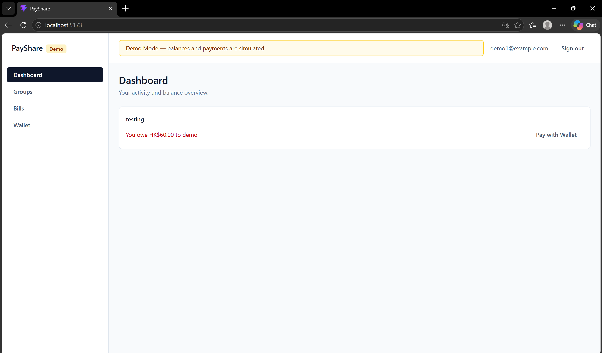
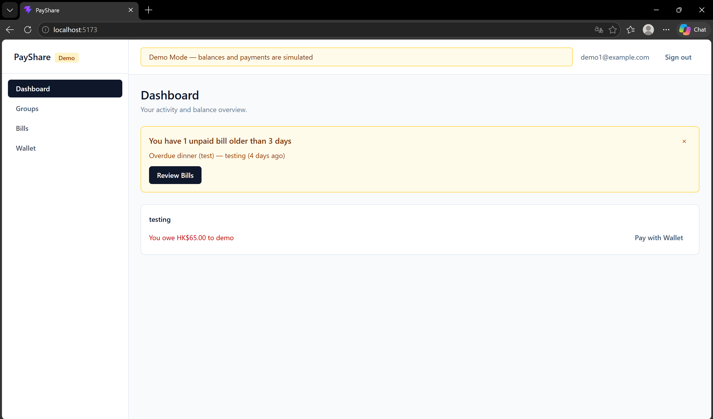
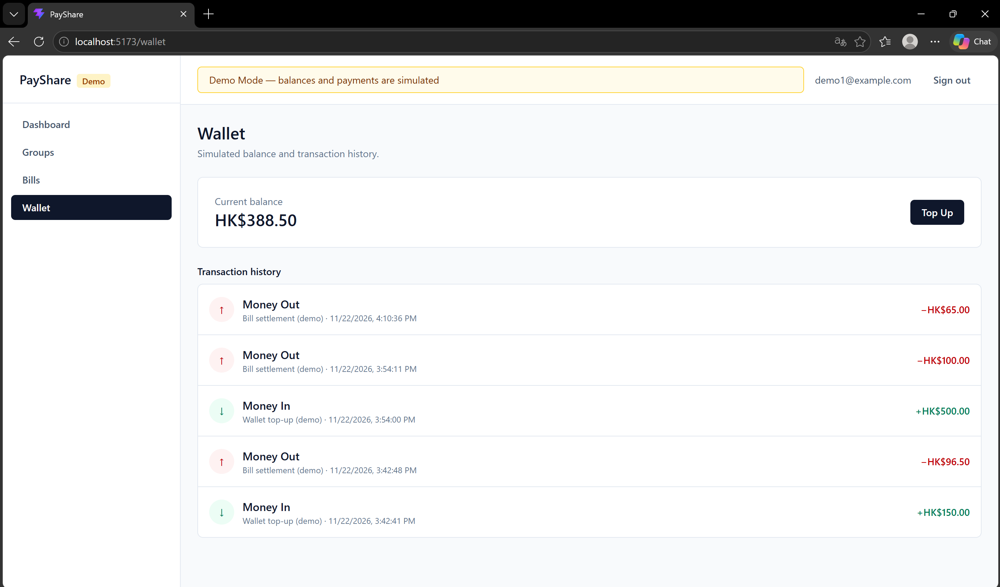
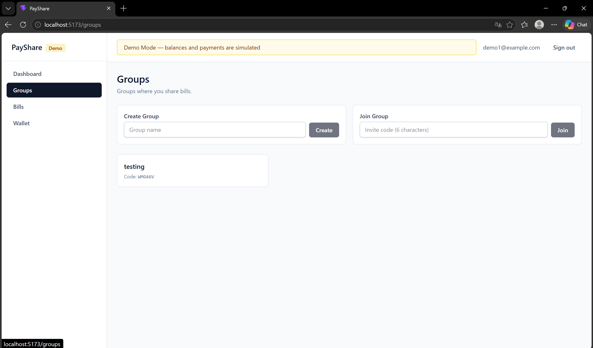
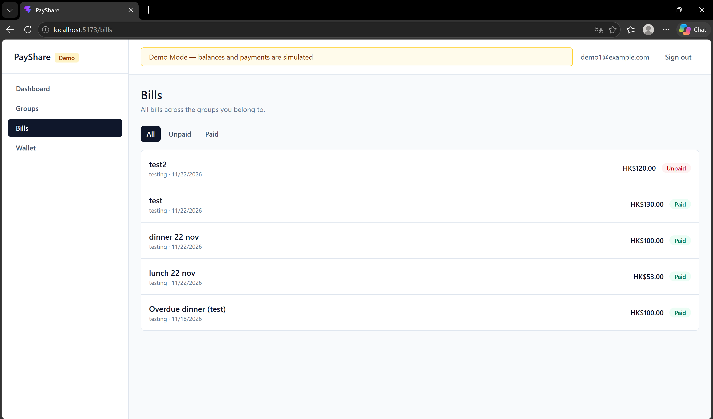

# PayShare

*A full-stack web application to split bills, track shared expenses, and settle debts using a simulated digital wallet.*

---

## Overview

Splitting bills among friends or roommates is often messy. Existing apps are either too complex or lack a built-in way to simulate actual payments.

PayShare solves this by providing a clean, straightforward platform to track who owes whom, complete with a simulated wallet feature to settle debts seamlessly.

---

## Features

- **Group creation & invite codes** — Create groups and invite others with a simple 6-character code.
- **Bill splitting (equal & custom)** — Divide a bill evenly or assign a custom amount to each participant.
- **Automated balance calculation** — The application computes who owes whom, minimizing the number of transactions required to settle up.
- **Simulated digital wallet** — Top up a demo balance and pay bills directly from it.
- **Overdue reminder** — A dashboard banner surfaces unpaid bills that are older than 3 days.

---

## Screenshots











---

## Tech Stack

| Layer | Technology |
| --- | --- |
| Frontend | React, Vite, TypeScript, Tailwind CSS |
| Backend / Database | Supabase (PostgreSQL, Auth, Row Level Security) |
| Testing | Vitest |

---

## Technical Decisions & Challenges

**Row Level Security (RLS)** is the foundation of data isolation. Every table has RLS enabled, and policies are written so that authenticated users can only read and modify rows they are entitled to. Group-related data (bills, members, settlements) is restricted to users who belong to the corresponding group, while wallet and transaction data is limited to its owner. Helper functions such as `is_group_member()` are defined as `SECURITY DEFINER` to evaluate membership without triggering recursive policy evaluation on the `group_members` table.

**Joining a group without leaking group data.** Because the `groups` table is protected by RLS, a user cannot read a group before becoming a member, which makes a naive "look up by invite code" approach impossible. PayShare solves this with the `join_group_by_code` RPC, implemented as a `SECURITY DEFINER` function. It reads exactly the row matching the provided code and inserts the caller as a member — exposing only the group the code points to, without making the full list of groups visible to the public.

**Balance calculation as a pure function.** The core debt-settlement logic lives in a standalone module (`src/lib/balance.ts`) that accepts plain data structures and returns the net transfers between users. It has no dependency on Supabase or the DOM, which makes it straightforward to unit test in isolation. The same pure functions are reused across the dashboard summary, the bills page, and the overdue reminder, guaranteeing consistent results everywhere.

Additional database operations that must be atomic — such as creating a group together with its owner membership, topping up a wallet, and paying a debt — are implemented as PostgreSQL functions (RPCs) so that partial failures cannot leave the data in an inconsistent state.

---

## Getting Started (Local Development)

### Prerequisites

- [Node.js](https://nodejs.org/) (version 20 or later recommended)
- A [Supabase](https://supabase.com/) account and project

### Installation

1. Clone the repository:

   ```bash
   git clone https://github.com/your-username/payshare.git
   cd payshare
   ```

2. Install dependencies:

   ```bash
   npm install
   ```

3. Configure environment variables. Copy the example file and fill in your Supabase project credentials:

   ```bash
   cp .env.example .env.local
   ```

   ```env
   VITE_SUPABASE_URL=https://your-project-ref.supabase.co
   VITE_SUPABASE_ANON_KEY=your-anon-public-key
   ```

4. Run the SQL migrations in your Supabase project. Open the **SQL Editor** in the Supabase dashboard and execute the files in the `supabase/` directory, starting with `migration.sql`.

5. Start the development server:

   ```bash
   npm run dev
   ```

### Available Scripts

```bash
npm run dev      # Start the development server
npm run build    # Type-check and build for production
npm run lint     # Run the linter
npm run test     # Run the unit tests with Vitest
```

---

## Important Note

> **This is a portfolio project. The wallet and payment features are strictly simulations. No real money is processed, and no payment gateway is integrated.**
